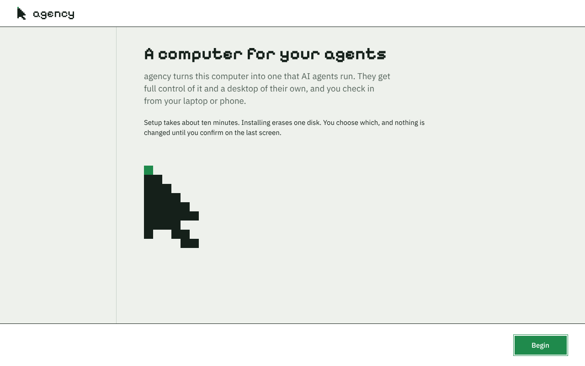

<p align="center">
  <picture>
    <source media="(prefers-color-scheme: dark)" srcset="docs/agency-dark.svg">
    
  </picture>
</p>

<p align="center">
  Turns a spare laptop into a computer for your agents.
</p>

Your agents get root and a desktop of their own, and your computer stays yours.

<p align="center">
  
</p>

## Install

You need an x86-64 laptop or PC with UEFI and TPM 2.0, a USB stick, and an SSH key on your GitHub account.

1. Write the installer to the stick. On a Mac or Linux:

   ```sh
   curl -fsSL https://agency.makors.xyz/flash | sh
   ```

   On Windows, download the ISO from [agency.makors.xyz](https://agency.makors.xyz) and write it with balenaEtcher, or Rufus in DD mode.
2. In the laptop's BIOS, turn Secure Boot off and TPM on.
3. Boot from the stick and answer the setup screen.

Then log in with the name you gave it:

```sh
ssh agent@agency
```

[docs/install.md](docs/install.md) has the details, including a stick that installs without asking anything.

## Use

Start any agent you picked. It already knows how the machine works.

```sh
agency                             # what the machine is doing
agency update                      # get the newest agency
agency secret set OPENAI_API_KEY   # a key your agents can use
```

Watch their desktop at `http://agency:6081/vnc.html` over Tailscale.
