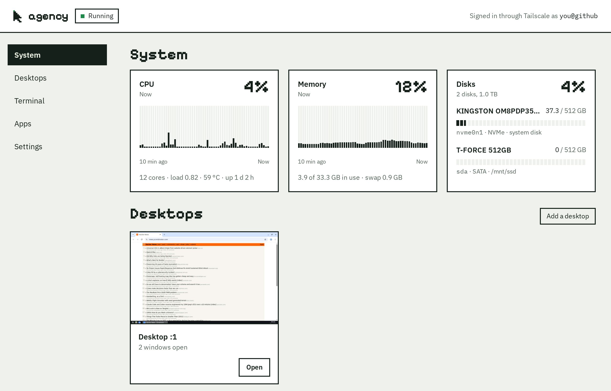

<p align="center">
  <picture>
    <source media="(prefers-color-scheme: dark)" srcset="docs/agency-dark.svg">
    
  </picture>
</p>

<p align="center">
  give your agents the computer you already have
</p>

<p align="center">
  
</p>

## Install

You need an x86-64 laptop or PC with UEFI, TPM 2.0 and a disk of 20 GB or more, a USB stick, and an SSH key on your GitHub account.

1. Write the installer to the stick. On a Mac or Linux:

   ```sh
   curl -fsSL https://agency.makors.xyz/flash | sh
   ```

   On Windows, download the ISO from [agency.makors.xyz](https://agency.makors.xyz) and write it with balenaEtcher, or Rufus in DD mode.
2. In the laptop's BIOS, turn Secure Boot off and TPM on.
3. Boot from the stick and answer the setup screen.

Then log in with the name you gave it, here `agency`:

```sh
ssh agent@agency.local   # on the same network
ssh agent@agency         # over Tailscale
```

[docs/install.md](docs/install.md) has the details, including a stick that installs without asking anything.

No spare computer? Try it in a virtual machine, on Linux with Nix:

```sh
nix --extra-experimental-features 'nix-command flakes' run github:makors/agency#vm
```

That, and running agency on a machine that already has NixOS, is in [docs/existing-nixos.md](docs/existing-nixos.md).

To run the installer itself in a VM (Proxmox, QEMU, VirtualBox, Hyper-V, VMware), set it up as in [Installing in a VM](docs/install.md#installing-in-a-vm).

## Use

Start any agent you picked. It already knows how the machine works.

```sh
agency                             # what the machine is doing
agency update                      # get the newest agency
agency secret set OPENAI_API_KEY   # a key your agents can use
agency backup restore ~/project    # bring back a file or folder from the hourly backups
agency export --home               # this machine's setup, to import on another
```

Or use the dashboard: the laptop's screen shows its address as a QR code. It works over Tailscale only.

## License

MIT. See [LICENSE](LICENSE).
