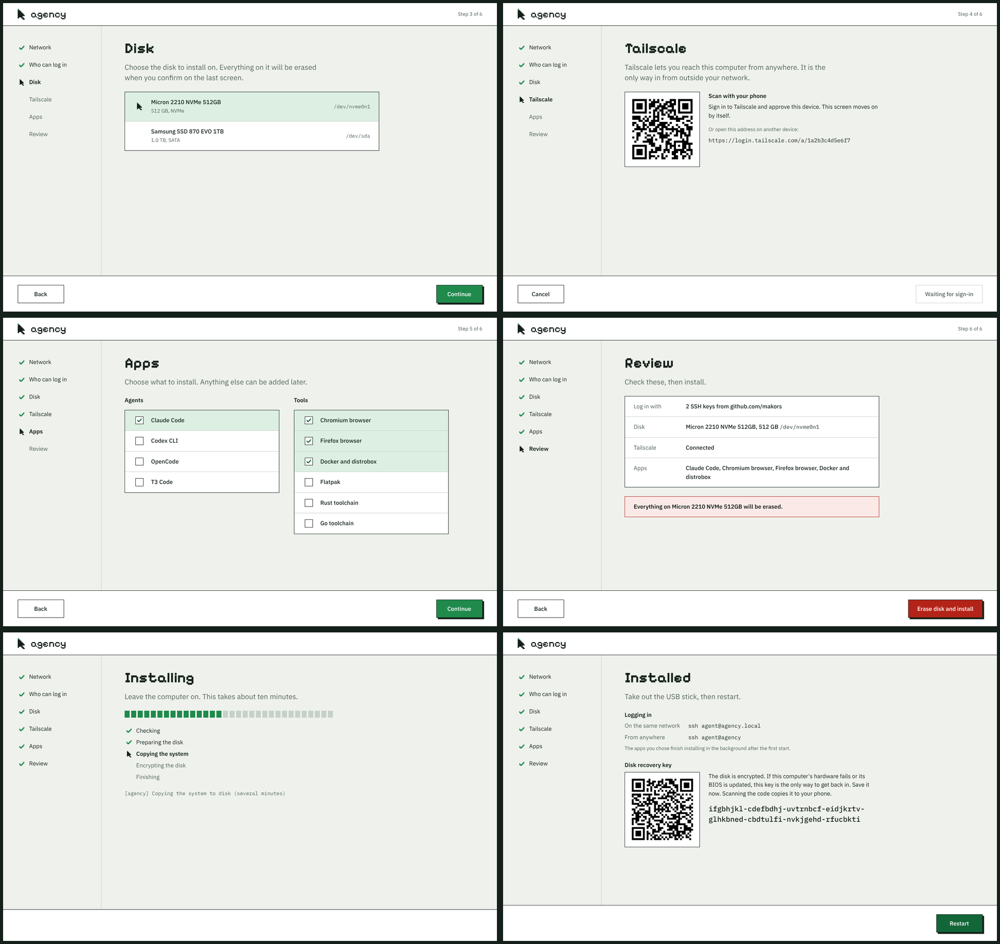

# Install details

## What you need

- An x86-64 laptop or PC with UEFI and TPM 2.0.
- A USB stick, 8 GB or more.
- Internet during the install. A cable is easiest; the wizard can also join Wi-Fi.
- A GitHub account with an SSH key on it. Password login is disabled, and the machine accepts the keys from `github.com/<you>.keys`.

On a Mac or Linux, `curl -fsSL https://agency.makors.xyz/flash | sh` downloads the newest ISO and writes it with [Caligula](https://github.com/ifd3f/caligula), which checks the ISO's SHA-256, lets you pick the stick, and verifies it afterwards. The ISO stays in `~/Downloads` for the next stick.

Otherwise download the ISO from [agency.makors.xyz](https://agency.makors.xyz) (newest build: `https://iso.makors.xyz/latest/agency-installer.iso`, details in `latest.json` next to it) and flash it with balenaEtcher or `dd`. In Rufus, choose **DD Image mode** when it asks; its ISO mode produces a stick that fails to boot.

## The setup screen

The stick boots into a setup screen on the laptop's own display. It works with the keyboard alone (Tab, arrows, Space, Enter) or with a mouse. It asks five things:

1. **Network.** If there is no connection it offers to join Wi-Fi.
2. **Name and login.** A name for the machine, and your GitHub username.
3. **Disk.** Pick the disk to erase from a list showing size and model.
4. **Tailscale.** Optional. A QR code appears; scan it with your phone and approve the device. The sign-in is carried over to the installed system.
5. **Apps.** Pick agents (Claude Code, Codex and others) and tools (browser, Docker and so on). The list comes from [`apps.nix`](../apps.nix).



Then it shows a summary. Nothing is erased until you press **Erase disk and install** there; that button never responds to Enter by accident.

After the install it shows the disk recovery key as text and as a QR code. Save it.

If the screen cannot start, for example on a machine whose graphics the installer does not support, the same questions appear as a text wizard. You can also reach a shell with Ctrl+Alt+F2 and run `sudo agency-install` yourself.

## After the first start

The stick carries a prebuilt system, so apps you added in the wizard are installed in the background the first time the machine starts. That can take ten minutes. Watch it with:

```sh
journalctl -fu agency-firstboot
```

When it is done, `/etc/nixos` is linked to this repo on GitHub, so `agency update` pulls new versions. To update from your fork instead, set `repo` in `/etc/nixos/settings.nix`; the next `agency update` switches to it.

## A stick that asks nothing

Fork the repo and edit `settings.nix`:

```nix
hostName = "lab";
githubUser = "you";
apps = [ "chromium" "docker" "claude-code" ];
unattended = true;
```

Push, and GitHub Actions builds your ISO. It boots, counts down 30 seconds, erases the disk and installs. Holding the power button during the countdown cancels.

Unattended installs choose the NVMe disk, or the SATA disk if there is no NVMe. They stop without touching anything if:

- `vendorMatch` is set and the machine's vendor doesn't match
- the machine already has an agency install, so a stick left plugged in can't reinstall in a loop
- there are two disks of the same kind and none is named in `settings.nix`
- no SSH public key was found

`sudo agency-install --unattended --force`, from the shell on Alt+F2, skips the first two checks. If the earlier install is on a different disk from the new target, `--force` erases that one as well. A stick like this installs on any machine it boots, so label it.

To join Tailscale unattended, format a second stick as FAT with the label `AGENCY` and put a one-time auth key on it in a file named `tailscale-authkey`. The installer also saves the disk recovery key to that stick.

## Limits

- Secure Boot must be off. TPM unlock protects the data if the disk is removed, but not if someone boots another OS on the machine.
- The disk recovery key is also saved to `/root/luks-recovery-key.txt`. Run `agency recovery-key` over SSH: it shows the key once and deletes the file.
- The remaining setup work is listed in [AGENTS.md](../AGENTS.md).
